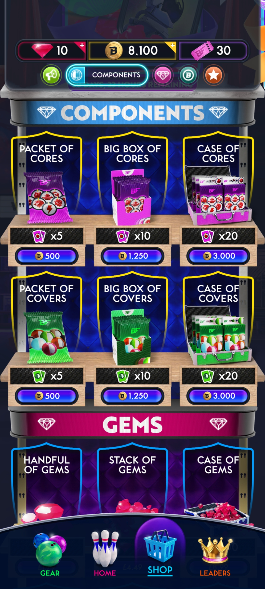
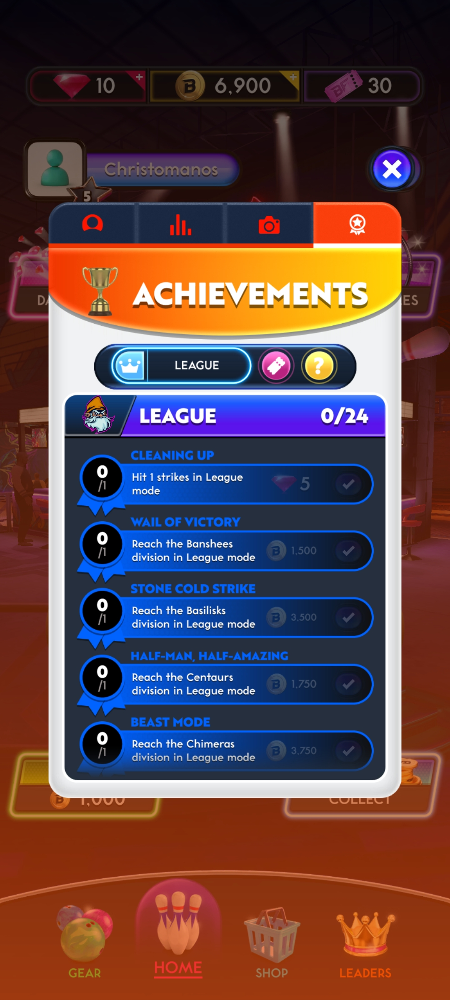

**Role**: Junior Software Developer

**Engine**: Unity

**Studio**: Yakuto/Miniclip

**Team Size**: 12

**Duration**: 1 year & 6 months

**Platforms**: Android/iOS

## Overview
---

In Bowling Fury, players slingshot their way through a realistic bowling experience while competing against opponents in fast-paced multiplayer matches.

This was the first production-quality game I worked on professionally. I joined shortly after the project entered production and became part of a small engineering team responsible for bringing the game from development to live release.

Working in a small team gave me the opportunity to contribute across a wide range of disciplines. Over the course of the project I delivered gameplay systems, progression features, cloud-backed services, localisation support, monetisation features, and player-facing UI/UX improvements.

My largest contributions included the Components monetisation feature, the Achievements system, the Obstacles game mode, progression and campaign features, and inventory and equipment systems. Throughout development I worked closely with designers, artists, QA engineers, product stakeholders, and fellow programmers to deliver and maintain features used by players worldwide.

-  100+ merged pull requests.
-  Delivered multiple player-facing features from concept to release.
-  Contributed across gameplay, UI/UX, backend integrations, and monetisation.
-  Worked on a live-service mobile game supporting ongoing content releases.
-  Collaborated in an Agile production environment.

## Contributions
---

### Components
The Components feature introduced a new monetisation and progression system to Bowling Fury, allowing players to acquire ball components, such as cores and coverstocks, through purchasable component packs available in the in-game store.

As part of the implementation team, I contributed across backend services, configuration, gameplay systems, and client integration. My work included extending existing data models and repositories, implementing cloud logic, integrating component ownership into player inventory systems, and connecting component data with bowling ball progression.

I also developed the weighted-random reward logic used by component packs, enabling configurable rarity distributions for monetised content. In addition, I contributed to store integration, reward presentation screens, and purchase confirmation flows to support the complete player experience from purchase through to reward fulfilment.

#### Key Contributions

- Extended backend systems with new entity types, mappings, repositories, and cloud logic for component management.
- Implemented shared client/backend models to support component data synchronisation.
- Added component integration to existing ball progression and customisation systems.
- Developed weighted-probability reward selection for component packs.
- Contributed to in-game store integration and pack configuration.
- Implemented reward screen and purchase confirmation flow integration.
- Added player inventory support for component ownership and progression.
- Developed automated tests for core feature functionality.

---

### Achievements System
The Achievements feature introduced structured progression goals that rewarded players for reaching gameplay milestones and completing specific challenges.

As part of the implementation, I contributed to both the backend achievement framework and the player-facing experience. I developed cloud-side services responsible for tracking achievement progress, managing achievement configuration, and evaluating completion criteria. I also integrated player progression data into the existing database systems, enabling achievements to be tracked and persisted across sessions.

Building on the core framework, I implemented gameplay-specific achievements related to player scores and shot performance. To support achievement visibility and engagement, I developed achievement notification toasts using the existing notification infrastructure, as well as UI functionality for achievement badges, claimable notifications, and achievement descriptions.

#### Key Contributions

- Developed cloud services for achievement tracking and progression management.
- Implemented achievement configuration and player progress data models.
- Integrated achievement data with existing backend and database systems.
- Implemented score-based and shot-specific achievement types.
- Developed achievement notification toasts using builder and factory patterns.
- Added achievement badges and claimable achievement notifications to the UI.

---

### Obstacles Game Mode

The Obstacles arcade mode introduced a new gameplay experience that challenged players to navigate arena hazards and environmental obstacles while progressing through dedicated Rookie and Pro difficulty levels.

I contributed to both the gameplay and user experience aspects of the feature. My work included creating and configuring Obstacles levels by collaborating with the product manager on the level design and extending the existing framework using the builder pattern. I also implemented mode-specific UI and connected progression systems by adding unlock requirements to the league path, ensuring the mode integrated naturally with the existing player progression experience.

#### Key Contributions

- Created and configured Rookie and Pro Obstacles levels.
- Implemented mode-specific UI and gameplay elements.
- Integrated Obstacles unlock progression into the league system.
- Updated localisation support for Obstacles and Achievements content.

---

## Live Service Engineering

Alongside ownership of larger gameplay features, I contributed to a wide range of live game systems, player progression mechanics, monetisation features, analytics, and quality-of-life improvements.

### UI & Player Experience
- Implemented reward dialogs, match end scenarios, and store presentation improvements.
- Improved ball selection, inventory management, and gameplay feedback systems.
- Added haptic feedback and gameplay quality-of-life improvements.

### Progression Systems
- Configured XP thresholds for player levels and leagues.
- Supported league promotion flows and progression rewards.
- Updated reward presentation and progression-related UI flows.

### Settings & Platform Features
- Added support for language switching and localisation.
- Implemented account deletion and privacy-related features.
- Added graphics and performance profile settings.
- Implemented settings functionality including volume controls and user ID utilities.

### Economy & Analytics
- Resolved analytics and telemetry issues relating to currency and item flows.
- Fixed reward tracking for store purchases, match rewards, league progression, and advertisements.
- Corrected product family and reference identifier issues affecting analytics reporting.